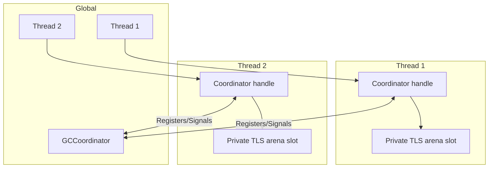
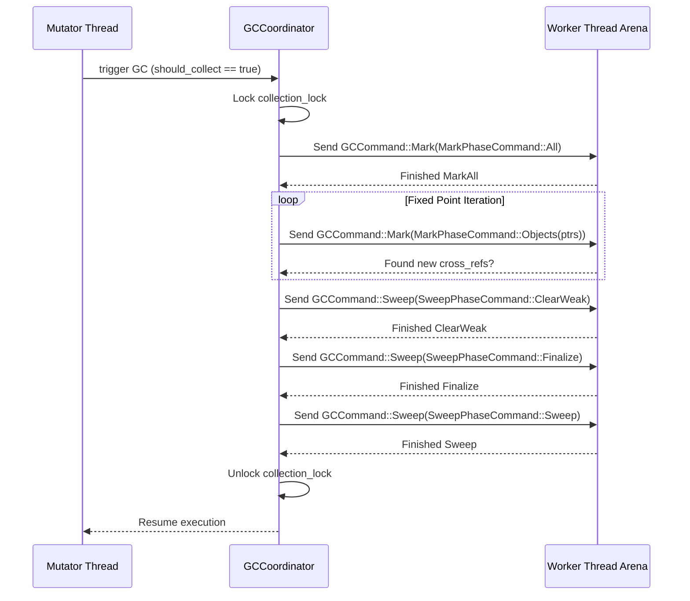

# Garbage Collection and Memory Safety

This document describes the garbage collection subsystem, memory safety invariants, and the cross-arena reference tracking system.

## Overview

`dotnet-rs` uses `gc-arena` as its underlying GC, extended with a custom **Stop-The-World (STW) coordinator** for multi-arena (multi-threaded) collection. The GC subsystem spans multiple crates:

- **`dotnet-vm/src/gc/`**: Coordinator and arena management
- **`dotnet-runtime-memory/src/`**: Heap manager, raw memory access, and memory ops
- **`dotnet-value/src/object/`**: Heap object representation (`mod.rs`, `heap_storage.rs`, `types.rs`)
- **`dotnet-value/src/storage.rs`**: Field storage with atomic capabilities
- **`dotnet-utils/src/lib.rs`**: `GcScopeGuard<'ctx>` and `BorrowScopeOps`
- **`dotnet-utils/src/gc/`**: GC utility types (`mod.rs`), `GCCommand`, `ThreadSafeLock` (`thread_safe_lock.rs`), arena helpers (`arena.rs`), and cross-arena refs (`cross_arena.rs`)

## Invariants

The `// SAFETY:` predicates this subsystem relies on are stated in the
[invariant registry](INVARIANT_REGISTRY.md): `F1.StwParked`, `F1.ArenaGenerationMatch`,
`F1.ExecutorArenaRetained`, `F1.RetiredCollectionExclusion`, `F1.FinalizerPublication`,
`F1.GcHandleRooted`, `F5.TracesEveryGcRef`,
`F6.NoEscapeAcrossArena` and `F9.MetadataArenaOutlivesDescriptors`.

## Managed pointer placement

ECMA-335 §II.14.4.2 and §III.1.1.5.2 separate where a managed pointer (byref) may *point* from
where a byref value may be *stored*.

**Targets.** A byref may point into any of the storage kinds named by `PointerOrigin`
(`crates/dotnet-value/src/pointer/origin.rs`):

| Variant | Target |
|---|---|
| `Heap(ObjectRef)` | a field or element of a GC heap object (object, array, box, string) in this arena |
| `CrossArenaObjectRef(CrossArenaOrigin)` | the same, for an object owned by another thread's arena (`multithreading` only) |
| `Static(Arc<StaticMetadata>)` | static field storage |
| `FrameHome(FrameHomeSerial)` | a local or argument in the [home block](#frame-owned-homes) of the live frame with that serial, on the current thread |
| `Stack(StackSlotIndex)` | an evaluation-stack slot, or a local or argument without a home, of the current thread (see [Evaluation stack, locals and managed pointers](ARCHITECTURE.md#evaluation-stack-locals-and-managed-pointers)) |
| `Transient(Arc<Object>)` | a value-type value that has no slot of its own, such as the result of `ldflda` on a value type on the evaluation stack |
| `Unmanaged` | unmanaged memory, including `localloc` blocks and addresses reconstructed from native integers |

**Storage.** A byref value may be stored only in:

- evaluation-stack slots, locals and arguments (`StackValue` slots of the evaluation stack, and
  [frame homes](#frame-owned-homes));
- fields of byref-like (`ref struct`) value types, which are themselves stored only in those
  slots. The layout factory gives a `by_ref` field the `Scalar::ManagedPtr` layout
  (`LayoutFactory::collect_fields` in `crates/dotnet-runtime-resolver/src/layout.rs`), as it does
  the `ByReference<T>` family.

A byref is never stored in a heap object, an array element, a static or a box. Consequently the
GC, the write barrier for heap stores and finalization never handle a byref stored in the heap,
and heap, array, static and box storage need no byref support.

**What the VM rejects.** The VM does not check heap stores for byrefs at run time; storing a
byref or byref-like value into a heap field, array element, static or box is invalid IL, and the
VM relies on the input being valid. The checks that exist are:

- A `by_ref` field is laid out only when its declaring type is byref-like (marked with
  `IsByRefLikeAttribute`, `ResolverService::is_byref_like`); otherwise the layout factory returns
  `TypeResolutionError::InvalidLayout`.
- `box` of a byref-like value throws `System.InvalidProgramException`.
- `System.TypedReference` cannot be laid out as a field or element or read from managed
  storage (`TypeResolutionError::InvalidLayout` from the layout factory and from
  `read_cts_value`).
- P/Invoke rejects signatures whose by-value arguments or return type are byref-like
  aggregates containing managed pointer fields (`preflight_byref_like_native_aggregates` in
  `crates/dotnet-pinvoke/src/call.rs`).

## Frame-Owned `localloc` Allocations

`localloc` storage is host allocation owned by the active method frame, not storage managed by the
`HeapManager`. `MethodState::allocations` (a `FrameAllocations`) retains one zero-initialized,
non-resizing `RawBlock` per request, so a later request cannot move or invalidate an earlier
block. Each block has at least 16-byte alignment, a retained allocation base and `Layout`, and a
separate payload extent; zero-byte requests still own a real one-byte block. Pointers are derived
from the retained base without forming an intermediate payload reference. `localloc` pushes the
block address as an unmanaged pointer.

The default limits are 128 MiB per request and per frame, and 512 MiB per thread. Checked accounting
charges at least 64 bytes for each block. A negative signed request maps to `System.OverflowException`;
request, frame, or thread budget exhaustion and other allocation failures map to
`System.OutOfMemoryException`.

Allocation lifetime follows frame ownership rather than the lifetime of a caller's local pointer:

- A caller's blocks stay live while nested callee frames execute. Suspending and restoring frames
  moves the owning frames and does not release their blocks.
- Normal return and exception unwind retire frames through the frame-recycling path, which releases
  their blocks before a frame can be reused. Tail-call and `jmp` replacement use that same recycling
  path, so the replaced frame's blocks end with it.
- Clearing the frame stack or destroying its arena releases blocks still owned by active,
  suspended, or pooled frames through normal Rust destruction. MT teardown can instead retain
  the arena and its frames when draining is incomplete.

Limits of this contract:

- The budget is a thread-local limit for frame allocations only. It is not connected to
  `HeapManager` allocation pressure or GC triggering.
- Guest use of a pointer after its frame's allocation lifetime ends is not detected.
- `localloc` inside an exception block is not rejected.
- Suspending frames while a nested exception filter runs has not been shown to preserve the
  suspended frames' blocks; source inspection suggests a possible overwrite, which has not been
  reproduced.

## Frame-Owned Homes

A local or argument whose address is taken lives in a non-moving block owned by its frame, so a
byref or native-int address taken from it stays valid while the evaluation stack grows and while
the variable is reassigned.

- **Selection.** `build_frame_homes` (`crates/dotnet-vm/src/frame_homes.rs`) scans the method
  body once per method instantiation and homes every local named by an `ldloca` and every
  argument named by an `ldarga`, including byref-typed variables and value-type `this`.
  `TypedReference` variables retain specialized stack slots; taking their address raises
  `InvalidProgramException` under the selected strict ECMA boundary (I.8.6.1.3 and II.7.1 prohibit
  typedref-byref signatures); CoreCLR-compatible unsafe typedref address-taking is not supported.
  Methods without supported address-taken variables get no home block.
  Evaluation-stack growth and suspension/restoration require no pointer fixup.
- **Layout.** The homes are fields of one block layout built by
  `LayoutFactory::create_field_layout`. Each home has its type's layout; a value-type variable
  uses its instance field layout, so a load rebuilds the value that was stored. The block is
  aligned to the larger of 16 and its largest home alignment (`FrameHomeLayout` in
  `crates/dotnet-vm-data/src/frame_homes.rs`).
- **Lifetime.** The frame owns a zeroed `RawBlock` (`FrameHomes`), allocated before the frame is
  pushed and released when the frame is reset for a new call, prepared for the pool, or dropped,
  like its `localloc` blocks. Zero bytes are the default value of every local; each homed
  argument is copied from its evaluation-stack slot when the frame is entered. `jmp` forwards
  the current home value before releasing the source frame.
- **Constructor receivers.** Ordinary, intrinsic and reflection value-type construction
  allocates a layout-described temporary home in the caller. Each block gets its own serial,
  shares the caller's localloc allocation limits, and remains live until the caller exits.
  Constructor completion copies its current contents into the reserved result slot before
  reflection return processing. `jmp` transfers completion to its target; exceptional completion
  discards the pending result. Temporary blocks are traced alongside variable homes.
- **Access.** Every access goes through a raw pointer derived from the block base; no reference
  to the bytes is formed except the shared view used while tracing and the read-only views
  `ManagedPtr::with_frame_home_data` hands to span intrinsics. Loads and stores encode values as
  value-type fields do: scalars in their CTS width, object references and managed pointers in
  their serialized forms. A store applies the ECMA-335 §III.1.6 conversions to native-int and
  small-integer variables.
- **Byrefs.** `ldloca` and `ldarga` on a homed variable push a `PointerOrigin::FrameHome` byref
  naming the home block's serial and the home's offset in the block. `FrameStack::issue_home_serial`
  gives every block a serial that is never reused on its thread, so a byref cannot resolve into a
  later frame at the same depth. Every access resolves the byref through `frame_home_window`
  (`crates/dotnet-value/src/pointer/mod.rs`): `FrameStack::home_block` searches the live frames
  from the current one down, then filter-suspended frames, for that serial. `VesContext` also
  searches the caller parked during finalizer execution. The accessed range must lie inside the
  block. Suspended homes stay allocated and traced across collection and
  restoration. Return, unwind, tail-call replacement, `jmp`, suspension discard and teardown
  release homes; pooled frames retain no home block.
  A byref whose frame has returned fails with `MemoryAccessError::InvalidOrigin`, which the
  instruction handlers report as a host error; an out-of-range access fails with
  `MemoryAccessError::BoundsCheck` and raises `System.AccessViolationException` like other
  failed accesses. The unchecked `ManagedPtr::with_data` family rejects a frame-home byref
  instead of using its cached address. The byref keeps its origin when it is copied to the
  evaluation stack, a homed variable or a `ref` field of a byref-like value; its serialized form
  is a tag-7 encoding described at `ManagedPtr::SIZE`.
- **Native addresses.** A byref's cached address is exposed when it is converted to a native
  integer (`conv.u`, `Unsafe.AsPointer`) or passed to native code, so that integer can be
  dereferenced as an `Unmanaged` address.
- **Tracing.** `StackFrame`'s `Collect` implementation traces the object references and
  managed-pointer origins serialized in the block through its field layout.

Limits of this contract:

- Like `localloc` blocks, a native-int address into a home is trusted after its frame returns;
  using it then is not detected.

## Pointer Ownership and Access

- **Transient ownership.** `PointerOrigin::Transient` holds a shared `Arc<Object>`: clones
  retain the same storage, and `normalize` and `ManagedPtr::from_info_full` preserve that owner.
  A Transient value is a snapshot of the value it was taken from; writes through it do not reach
  any local, argument or heap location. Fallible memory stores, native-integer conversions,
  `Unsafe.AsPointer` and CLI-to-CTS numeric narrowing reject a Transient byref instead of
  exposing its address; infallible raw codecs do not perform this check.
- **`RetainedPtr`.** Access-performing stack pops (`pop_retained_ptr`) return a `RetainedPtr`
  that owns the popped `StackValue` for the synchronous operation; with `multithreading`, a
  cross-arena operand also holds an arena lease. It does not hold a heap borrow, and must be
  dropped before the thread parks at a safepoint.
- **Observation.** `pop_address` returns an address with no owner. `resolve_address` borrows
  the origin; its result and `ManagedPtr::observe_address` are address observations, not access
  permission, a lasting lease, a storage guard or a range proof.
- **Caller obligations.** Every access through any of these still needs provenance, extent,
  initialization, alignment, aliasing, rooting and synchronization established by the caller
  (`F10.RawMemoryAccessValid`).

Cross-arena checked accesses take a lease per closure or operation; observation and resolution
take only a temporary lease. The lease protocol is described under
[arena liveness and leases](#arena-liveness-and-leases).

## Arena Architecture

### Per-Thread Arenas
`Executor::new` creates a boxed `GCArena`; `Executor::with_arena` gives controlled mutable
access. Without `multithreading` the Box is stored directly in the Executor, with no TLS
extraction backend or cross-arena drain. With `multithreading` a private TLS
`RefCell<Option<Slot>>` holds an initializing or exact-identity owner reservation and an optional
Box. The reservation is independent of the Box: reentrant construction is rejected until the
owner drops, and construction rollback releases the reservation.

MT `extract_arena` transfers the Box and exact registration to an `ArenaGuard` at most once;
subsequent extraction returns `None` and arena operations are unavailable. The reservation stays
with the Executor even if the guard drops first. The guard may outlive the Executor on the same
thread; it never touches TLS, so it cannot take a successor's arena. `Executor` is `!Send` and
`!Sync` in both modes; the MT guard is also `!Send` and `!Sync`. The TLS slot is private:
construct and use each Executor on its owning thread.

On MT Drop, retention is armed before fallible cleanup. The owner removes its coordinator and
thread bookkeeping and, if it still owns the Box, drains the captured exact registration; the
guard drains that registration if extracted. Removal makes the entry unavailable to new leases
before the drain completes. Only `Drained` permits destruction; a self-held lease, missing
registration, or interrupted drain/cleanup deliberately leaks storage. Drain waits outside registry
and coordinator locks and TLS borrows. TLS destruction also leaks a residual Box (e.g. a forgotten
Executor), not a substitute for drain. Drop may panic and incomplete cleanup can leave bookkeeping;
retention is not a promise of non-panicking Drop or recovery. No final full GC is performed by
Executor Drop.

#### Retired worker arenas

In `multithreading`, a managed worker that completes its entry point does not immediately drop its
executor. After cleaning up the managed segment, it publishes the completion outcome and enters
`Executor::serve_retired`. The owner thread and arena remain registered with the GC coordinator and
the exact-identity lease registry. A retired owner counts as stopped for stop-the-world and services
the coordinator's mark, finalize and sweep commands; it never resumes its ordinary managed entry
point. When a sweep queues finalizers, the owner runs only finalizer segments, services their safe
points, and returns to the retirement loop.

Shutdown starts only from that service loop. The owner excludes collections, rechecks that no
finalizer is queued, marks the worker as shutting down, and unregisters its exact arena identity.
It then drains outstanding leases outside the collection lock before freeing the arena. If exact
drain cannot complete, storage is deliberately leaked. These ordering requirements are
`F1.RetiredCollectionExclusion` in the [invariant registry](INVARIANT_REGISTRY.md) and the
[retained-arena design](plans/09-retired-arena-lifetime.md#design). The cost and ID-space limit for
retaining completed workers are recorded in the
[worker lifecycle contract](THREADING_AND_SYNCHRONIZATION.md#managed-worker-lifecycle-and-process-exit).

The following is an MT schematic: coordinator handles are not themselves TLS arena storage.

### `GCCoordinator` (`gc/coordinator.rs`)

Two implementations are selected via the `multithreading` feature flag:

**Multi-threaded (`cfg(feature = "multithreading")`)**:
- Tracks all arena handles via `register_arena`/`unregister_arena`.
- Monitors allocation pressure via `ArenaHandleInner::record_allocation`. If `allocation_counter + size > ALLOCATION_THRESHOLD`, sets a `needs_collection` flag. The coordinator checks this flag in `should_collect`.
- Uses a lock-backed RAII session model:
  - `begin_collection()` `try_lock`s the coordinator lock and returns `Option<CollectionSession>`. `None` means another thread is already collecting, so the caller bails out (no blocking acquire).
  - While `CollectionSession` is alive, collecting-only operations (command dispatch / wait / fixed-point marking) flow through the session.
  - `finish()` ends the session; dropping a still-live `CollectionSession` also restores Idle state (`stw_in_progress=false`, lock released).
- Orchestrates STW collection via `collect_all_arenas` using a phase-based approach. In `Executor::perform_full_gc` the `CollectionSession` and the `StopTheWorldGuard` are bound together into a `GcCycleGuard` (which enforces drop order: session cleanup before thread resume), and `collect_all_arenas` is invoked through that guard:
  1. **Phase 1 (MarkAll)**: Acquires collection lock, clears cross-arena references table, and sends `GCCommand::Mark(MarkPhaseCommand::All)` to all arenas.
  2. **Phase 2 (Fixed-point MarkObjects)**: Repeatedly sends `GCCommand::Mark(MarkPhaseCommand::Objects(…))` for cross-arena references discovered during marking. Iterates until no new cross-arena references are found.
  3. **Phase 3 (ClearWeak)**: Sends `GCCommand::Sweep(SweepPhaseCommand::ClearWeak)` and waits for every arena. Each arena zeroes its short weak handles whose targets are unreachable. This reads object colors without changing them, and it must finish everywhere first: a handle can target an object another arena owns, and that arena's `Finalize` resurrects (recolors) finalizable objects. Running both in one concurrent phase made a cross-arena `WeakReference` survive the first `GC.Collect` depending on which arena ran first.
  4. **Phase 4 (Finalize)**: Sends `GCCommand::Sweep(SweepPhaseCommand::Finalize)` to queue unreachable finalizable objects.
  5. **Phase 5 (Sweep)**: Sends `GCCommand::Sweep(SweepPhaseCommand::Sweep)` to all arenas to reclaim dead objects.

**Single-threaded (`cfg(not(feature = "multithreading"))`)**:
- Stub implementation — `should_collect` always returns false. The executor collects locally through `GCArena::collect_single_threaded`: allocation debt incrementally, and a full cycle when `GC.Collect` requests one.
- Every cycle stops when fully marked so `finalize_check` runs before sweeping, mirroring phases 3 through 5 above (one arena, so the weak-handle clearing inside `finalize_check` already precedes resurrection). The finalization queue holds finalizable objects weakly, so a cycle that swept first would free objects the queue still points to. gc-arena's `collect_debt` passes through the fully marked phase without stopping, so the executor never calls it.
- No cross-arena tracking needed.

### `GCCommand` enum
Defined in `dotnet_utils::gc::GCCommand`, split into two phase-typed inner enums:
- `Mark(MarkPhaseCommand)`:
  - `MarkPhaseCommand::All` — start marking phase, trace all local roots in the arena.
  - `MarkPhaseCommand::Objects(MarkObjectPointers)` — trace specific typed cross-arena object pointers.
- `Sweep(SweepPhaseCommand)`:
  - `SweepPhaseCommand::ClearWeak` — zero short weak handles whose targets are unreachable, before any arena resurrects a finalizable object.
  - `SweepPhaseCommand::Finalize` — queue unreachable finalizable objects.
  - `SweepPhaseCommand::Sweep` — reclaim unreachable objects.

### Global finalizer completion

`SharedGlobalState` tracks whether each arena has queued or in-progress finalizers and counts each
contributing arena once. Collection publishes newly queued work before the stop-the-world cycle
ends; finalizer-segment retirement and arena teardown update the same contribution. Ordinary
`GC.WaitForPendingFinalizers` completes only when no live or retired arena has pending or active
finalizer work. Its effects path waits outside an arena mutation and rechecks the global count while
servicing GC stops. A call made from within a finalizer returns immediately through the synchronous
selector and legacy fallback; it does not clear `processing_finalizer`. `F1.FinalizerPublication` records
the publication invariant and its falsifiers.

## Lock Order

GC and threading locks are acquired in the order declared by `define_lock_order_dag!` in
[`crates/dotnet-utils/src/sync/lock_order.rs`](../crates/dotnet-utils/src/sync/lock_order.rs),
with negative `AcquireAfter` assertions rejecting known inversions. The chains, forbidden
inversions and sequencing rules are tabulated once, in
[Threading and Synchronization](THREADING_AND_SYNCHRONIZATION.md#canonical-lock-order-multithreading).

## Cross-Arena Reference Tracking

When an object in arena A stores a reference to an object in arena B, this must be tracked so arena B's collector doesn't reclaim the referenced object prematurely.

### Arena Liveness and Leases

Cross-arena registration (`dotnet-utils/src/gc/cross_arena.rs`) is backed by `ArenaState` entries in a global registry:

- `ArenaState` contains `stw_in_progress`, `active_leases`, `is_alive`, and a monotonically increasing `generation`.
- `try_acquire_lease(arena_id)` returns an `ArenaLease` guard that increments `active_leases`.
- `unregister_arena` removes the entry, flips `is_alive`, then waits until `active_leases == 0` before returning. A fresh acquisition fails once the entry is removed; a pre-existing lease can complete. With `memory-validation`, the holder thread's tracked lease permits its in-flight validation after removal, without authorizing a fresh lease.

**A lease is not a root.** A lease prevents teardown of the arena for the duration of the covered
access. It does not keep any object reachable, check ranges, order shared-memory accesses, or
protect a later use of an address observed under it. Reachability needs a rooted handle or the
cross-arena root protocol below (`F1.GcHandleRooted`). Leases must be dropped before a thread
parks at a safepoint.

`CrossArenaRef` retains the allocation-derived raw pointer and `ArenaIdentity` (ID and generation) through the write barrier, found buffer, coordinator and commands; numeric addresses are keys for equality/deduplication, not pointer reconstruction. Harvest reacquires an exact-identity lease; installation additionally compares the owner arena’s original identity before conversion. STW records a real generation, not a wildcard. Ordinary `CrossArenaOrigin` also carries identity and a non-reused registration token; its managed-pointer codec resolves the token on decode, rejecting old registrations after ID reuse. The retained pointer does not root the object either.

Registration rejects duplicate live IDs; checked generation and token allocation fail on exhaustion rather than wrap. VM managed IDs are monotonic, 1..=65535, and exhaustion fails before registration. The 64-bit compact `ObjectRef` codec supports registered IDs 0..=65535 and nonzero aligned addresses below 2^48, with release-enforced checks and unsigned ID decoding. Its one-word representation stores no generation: unsafe decode requires the original allocation to remain live, rooted and provenance-valid for the required lifetime, even if an ID has been reused.

### How References Are Recorded
- Memory mutations occur through `RawMemoryAccess` (`dotnet-runtime-memory/src/access.rs`).
- `RawMemoryAccess::write_value_internal` (and unaligned/atomic equivalents) checks the `ArenaId` of the written `ObjectRef` or `ManagedPtr` against the destination `MemoryOwner` (the enum is defined in `dotnet-runtime-memory/src/write_barrier.rs`).
- If a cross-arena scenario is detected, it calls `record_objref_cross_arena_with_recorder` or `record_managedptr_cross_arena_with_recorder`.
- Bulk operations like block copying (`initblk`, `cpblk`) use `record_refs_recursive_with_recorder` and `record_refs_in_range_with_recorder` to scan the layout's GC descriptor and record any contained references.

### Weak References
The VM supports `GCHandleType::Weak` and `WeakTrackResurrection` (§I.8.2.4).
- **Implementation**: `HeapManager::clear_dead_weak_handles` (the multi-arena `ClearWeak` phase) and `HeapManager::finalize_check` zero-fill short weak handles for unreachable objects before any finalizable object is resurrected. The `GCHandle` intrinsics use opaque slot IDs with two clear low bits for CoreLib's handle tags; `System.WeakReference` liveness is tested in its handle's owning arena. [Cross-thread handle access](plans/README.md#not-yet-planned) remains limited.
- **BCL Support**: `System.WeakReference<T>` is not in the BCL support library and must be defined by the user or added to `support.dll`.
- **Cross-Arena Limitation**: The `GCCoordinator` fixed-point iteration only resurrects strong references. Short weak handles are cleared per owning arena in the `ClearWeak` phase, using the target's color even when another arena owns it. `WeakTrackResurrection` handles whose target another arena resurrects are not coordinated.

## GcScopeGuard and Deadlock Prevention

### The Problem
`gc-arena` requires exclusive access to an arena for collection. If a thread holds a borrow on a heap object (via `Gc::borrow`) when STW is requested, it cannot release the arena, leading to a deadlock. Furthermore, traversing the heap during a STW pause while mutator threads hold locks can also cause deadlocks.

### The Solution: `GcScopeGuard<'ctx>` (`dotnet-utils/src/lib.rs`)
- `BorrowScopeOps` trait (GC scope API): `enter_gc_scope()` / `exit_gc_scope()` / `active_gc_scope_depth()`.
- `GcScopeGuard<'ctx>` is an owner-carrying RAII guard. The lifetime parameter `'ctx` ties the guard to the lifetime of the `BorrowScopeOps` context, preventing use-after-free at compile time.
- Construct via `GcScopeGuard::enter(ctx, token)` — increments the `active_borrows` scope counter; when `counter > 0`, `VesContext`'s `RawMemoryOps::check_gc_safe_point` immediately returns `false` without blocking or polling the thread manager. (The plain `CallStack::check_gc_safe_point` does not consult this counter — it only loads `is_gc_stop_requested()`.)
- RAII — `Drop` decrements the counter.
- **`ThreadSafeLock` tracing**: Mutable guards increment a thread-local safepoint-exclusion counter. A thread holding such a guard remains running until it releases the guard, and an initiating thread is rejected if it attempts to begin STW in that state. The `Collect for ThreadSafeLock<T>` implementation uses `try_read()` and fails fast if this protocol was violated; that implementation never forms a shared reference by bypassing the lock. Other STW-only raw-storage reads remain separately documented at their call sites and rely on all mutators having stopped.

### Rules (enforced by convention, not compiler)
1. Never call `check_gc_safe_point()` while holding a heap borrow.
2. Never allocate while holding a heap borrow (allocation may trigger GC).
3. Always use `GcScopeGuard::enter(ctx, token)` when holding heap borrows in instruction handlers/intrinsics.
4. Chunk large operations — e.g., in string/span/unsafe intrinsic handlers (`dotnet-intrinsics-string`, `dotnet-intrinsics-span`, `dotnet-intrinsics-unsafe`) — and check `ctx.check_gc_safe_point()` periodically, dropping and re-acquiring `GcScopeGuard` between chunks.

## Cross-GC-Safe-Point Continuations

The interpreter reaches GC safe points between `arena.mutate_root(|gc, engine| engine.run(gc))`
calls. Any VM state that must survive that return must live in `Collect`-traced storage reachable
from the root (`ExecutionEngine<'gc>` → `CallStack<'gc>` → `ThreadContext<'gc>`), or in traced
per-frame state (`StackFrame<'gc>`).

### Static initializer failures

An initializer that throws a managed exception retains its `TypeInitializationException` in a
traced `FieldStorage` reference slot owned by its `StaticStorage`. The wrapper retains the
original inner exception; publication precedes the failed-state release and waiter notification.
Both legacy initializer unwinding and the effects claim publish to this storage. An abandoned
claim publishes failure without an exception object. Reads decode retained references only within
a live arena mutation. Retired worker owners remain available for collection and foreign-reference
decoding until shutdown, as described in [managed worker lifecycle](THREADING_AND_SYNCHRONIZATION.md#managed-worker-lifecycle-and-process-exit).
The aligned static-reference atomic path has a known provenance limitation under Miri; see
[shared raw-memory access](plans/README.md#not-yet-planned).

### Resume families

1. **Re-run/resume interpreter control flow in-place**
   - Uses `VmContinuation<'gc>` on `ThreadContext<'gc>`.
   - Covers retrying the current instruction and preserving nested handler-unwind queues.
2. **Retain native progress and call managed code**
   - Uses the `CallState` activation stack, separate from handler-unwind state.
   - Retains traced operands and root sets across executor turns; a managed child carries its
     native return destination on its frame. The root-transfer contract is in the
     [invariant registry](INVARIANT_REGISTRY.md).
   - A condition wait is retained by its activation and replies are checked against the effect
     kind and generation. Monitor release epochs only make waiters eligible to probe again;
     acquisition occurs inside a fresh mutation. `Executor::run` schedules finalizers first and
     waits without a mutation or arena lease, in bounded intervals so GC stops are serviced.
     Ordinary finalizer waits check the global pending-or-active arena count using this protocol;
     calls made while `processing_finalizer` is set return immediately through both the selector
     and the legacy fallback, while other non-inline calls retain their legacy retry. Admitted
     monitor calls use the same condition driver; excluded shapes retain their legacy paths.
3. **Resume with return-value post-processing after a managed call returns**
   - Uses per-frame `FrameReturnAction` on `StackFrame<'gc>`.
   - Covers excluded reflection calls using the synchronous fallback; admitted calls transform
     their own results in their activation.

### `VmContinuation<'gc>`

`VmContinuation<'gc>` is the unified, `Collect`-traced encoding of cross-safe-point interpreter
continuation state:

- `None` — no pending continuation state.
- `RetryInstruction` — previous safe-point yield requested an instruction retry (IP/stack restored
  before yielding). This marker is cleared on VM re-entry; the restored IP/stack is what actually
  drives the retry.
- `HandlerUnwinds(Vec<UnwindState<'gc>>)` — queued unwind states for nested `leave`/`finally`
  transitions that may span safe points.

### `FrameReturnAction`

`FrameReturnAction` is a per-frame continuation action for return handling. The current variant is:

- `InvokeReturn(RuntimeType)` — after a legacy reflection call returns, apply boxing,
  coercion and null handling using the captured return type metadata. Admitted reflection
  calls instead root their arguments and constructed receiver in a native activation and
  transform their own successful result. Declared byref returns are rejected before dispatch.

Because `FrameReturnAction` contains only `'static` metadata (`RuntimeType`), it does not add any
new GC references to trace. A reflected target delayed by its type initializer retains a traced
`ReflectionPending` on the caller, so initializer completion retries that target without applying
its return action. Synchronous completion applies the action immediately; exceptional unwinding
and frame retirement clear it.

### `VesContext` continuation API

`VesContext` exposes explicit helpers for continuation state transitions:

- `yield_and_retry()` — for legacy initializer triggers, records `VmContinuation::RetryInstruction` when no traced continuation
  state is already queued, restores the instruction snapshot via `back_up_ip`, then returns
  `StepResult::Yield`. If handler-unwind state is already present, that state is preserved because
  the retry itself is encoded by the restored IP/stack snapshot.
- `set_frame_return_action(action)` — stores the per-frame `FrameReturnAction` for excluded
  reflection calls' post-return handling.
- `push_handler_unwind(state)` / `pop_handler_unwind()` — mutate
  `VmContinuation::HandlerUnwinds` as unwind work is suspended/resumed.

### Finite native copies

Inline `call` and `callvirt` instructions, including tail, constrained and single-cast delegate
targets, retain large `Substring` copies in a native effects activation in both configurations. The source is held in the
activation's `DynamicRootSet`; the destination buffer contains UTF-16 code units and no
GC references. Arguments are consumed once before copying. Each executor turn copies at
most 64K code units, then yields if incomplete. Heap borrows end before yielding. The
executor services collection requests and abort/budget checks between turns.

The caller remains at the call instruction until completion publishes one result and
advances its IP once. Resumption checks caller depth, IP and operand-stack height.
Queued finalizers run in a separate managed segment while the copy remains rooted and parked.
Terminal executor results clear retained native work. Non-inline reflection uses the synchronous
intrinsic path; indirect `calli` is unsupported. Eligible calls issued by native effects can also
enter the async copy.

### GC handles and Rust futures

`gc-arena` brands `Gc<'gc, T>` handles with an invariant lifetime scoped to mutation
closures. Native futures retain references through activation-owned roots, not branded
handles, and access the heap through bounded poll-scoped effects. Multicast byrefs retain a
traced heap origin or a frame-home serial and offset; each fetch reconstructs the pointer after
checking its owner. Static-field and other excluded origins stay on the existing delegate path.
Static-field instructions retain a store operand in traced activation storage while initialization
runs; their completion action performs the field operation and advances the caller only after
initialization succeeds. The static-address result retains its static origin.

## Panic-Safety Guarantees During STW

`ThreadManager::request_stop_the_world` uses a `ResumeOnPanic` guard (`crates/dotnet-vm/src/threading/basic.rs`) that calls `resume_threads()` if any panic occurs before ownership is handed to `StopTheWorldGuard`. This prevents mutator threads from being left permanently paused.

`CommandCompletionGuard` in `crates/dotnet-vm/src/gc/coordinator.rs` is typestated (`Armed`/`Disarmed`):
- In `Armed` state, `Drop` calls `command_finished`.
- `disarm(self)` consumes the guard and returns `Disarmed`, whose `Drop` is a no-op.
- This guarantees exactly one completion signal on panic paths and avoids duplicate completion on normal paths.

Write-barrier TLS buffers are drained on panic unwind by `WriteBarrierPanicFlushGuard` (`crates/dotnet-runtime-memory/src/write_barrier.rs`), a zero-sized RAII guard placed at write sites. Its `Drop` impl flushes `WB_LOCAL_BUF` only when unwinding, while normal execution continues to batch until threshold/safepoint flush.

## HeapManager (`dotnet-runtime-memory/src/heap.rs` & `dotnet-runtime-memory/src/ops.rs`)

The `HeapManager` tracks object lifetimes, registration, and finalization:
- **Finalization**: Scans registered objects during `finalize_check` and queues unreachable ones with finalizers to a finalizer thread/queue.
- Coordinates with `dotnet-runtime-memory/src/ops.rs`, which defines a thin `MemoryOps` trait that extends `BaseMemoryOps` with a single `heap()` accessor. The concrete allocation paths (`new_object`, `new_vector`, `box_value`) live on the `MemoryOps` trait in `dotnet-vm-ops/src/ops.rs`.

## RawMemoryAccess (`dotnet-runtime-memory/src/access.rs`)

A critical abstraction providing memory safety over unsafe heap storage. The core implementations are `read_value_internal` and `write_value_internal`, which handle the actual data transfer and reference tracking. Higher-level APIs like `write_to_heap` and `write_to_unmanaged` provide additional safety checks and bounds validation. Operations include:
- **Unaligned reads/writes**: Validates reads/writes matching the `unaligned.` CIL prefix against `LayoutManager` invariants.
- **Atomic operations**: Compare-exchange, exchange, load, store. Respects .NET memory models (`Ordering` abstractions).
- **Bounds checking**: `check_bounds_internal` validates pointer arithmetic against `base` and `len`.
- **Interlocked alignment guards**: `compare_exchange_atomic`, `exchange_atomic`, and
  `exchange_add_atomic` check owned and unmanaged addresses before invoking atomic APIs.
  Misaligned Interlocked operations surface to managed code as `DataMisalignedException`.
  `load_atomic` and `store_atomic` instead retain the lock-guarded memcpy fallback required for
  valid misaligned volatile locations.
- **Reference integrity**: `validate_ref_integrity` ensures GC reference slots aren't partially overwritten (e.g. by overlapping struct copies).
- **Cross-arena tracking**: Checks all reference stores.
- **`MemoryOwner`** (defined in `dotnet-runtime-memory/src/write_barrier.rs`): `Local(ObjectRef<'gc>)` or, with multithreading, `CrossArena(CrossArenaOrigin, GcLifetime<'gc>)`. The origin retains pointer, identity and token; the lifetime token comes from a real GC context, not a foreign brand or object root. Access still requires the matching lease, object liveness and appropriate storage guard.

## FieldStorage (`dotnet-value/src/storage.rs`)

Provides atomic-capable raw byte storage for object fields:
- Backed uniformly by `dotnet_utils::sync::RwLock<Vec<u8>>` in every build configuration. The synchronization boundary selects `parking_lot::RwLock` with `multithreading` and the `RefCell`-based compatibility lock otherwise.
- Supports synchronised/atomic field access (`get_field_atomic`, `set_field_atomic`) under various memory ordering models.
- Provides `raw_data_ptr()` returning `*mut u8` for low-level or STW-GC tracing access.
- Atomic field access does not define ordering against overlapping non-atomic, different-width
  or raw-alias accesses to the same bytes; there is no common shared-memory access protocol
  ([not yet planned](plans/README.md#not-yet-planned)).

## Object Representation (`dotnet-value/src/object/`)

Heap objects are represented via several layers of abstraction, split across `mod.rs`, `heap_storage.rs`, and `types.rs`:
- **`HeapStorage`**: Enum holding distinct memory models: `Vec(Box<Vector>)`, `Obj(Box<Object>)`, `Str(CLRString)`, `Boxed(Box<Object>)` (the non-string variants are boxed).
- **`ObjectInner`**: Wraps `HeapStorage` and unconditionally carries `owner_id: ArenaId` in all build configurations. Under `cfg(any(feature = "memory-validation", debug_assertions))` (i.e. also in all debug builds) it embeds a `magic` number (`0x5AFE_0B1E_C700_0000`).
- **`ObjectPtr`**: A transparent, Send/Sync wrapper over a raw pointer to a `ThreadSafeLock<ObjectInner>`. Used primarily for cross-arena references.
- **`ObjectRef`**: A GC-managed handle wrapping the `ThreadSafeLock`. Implements `PointerLike` and `Collect`.
- There is no .NET-style object header. `ObjectInner` holds the monitor's `sync_block_index` as an ordinary field (`0` means no sync block yet), and each `Object` carries its `TypeDescription`.

## GC Collect Trait Implementations

All types stored in the GC heap or referenced by the VES stack must implement `gc_arena::Collect`:
- **`#[derive(Collect)]`**: Used for types where automatic tracing of all fields is sufficient (e.g., `ObjectInner`). The `#[collect(no_drop)]` attribute is often used to ensure safety.
- **`static_collect!`**: Used for leaf types that contain no further GC references (e.g. primitive wrappers, basic configs).
- **Manual Implementations**: Complex types with specialized tracing logic (like cross-arena reference tracking in `ObjectRef`) or those requiring custom validation manually implement the `trace<Tr: Trace<'gc>>(&self, cc: &mut Tr)` method. The `Collect` implementations iterate through all child elements, calling `.trace(cc)` recursively to maintain the GC reachability graph.

## Upstream Crate Contributor Notes

### `gc-arena`: Mutation Token and `'gc` Branding Guarantees

**Source reference:** `gc-arena` v0.6.0, `Arena::mutate` and `Arena::mutate_root`.

`gc-arena` enforces memory safety through two complementary mechanisms that every contributor working near the GC boundary must understand:

#### Mutation Token (`&Mutation<'gc>`)
All GC-managed allocation and reference writes require a `&Mutation<'gc>` token, which is only issued inside an `Arena::mutate(|mutation, root| { ... })` closure. This token proves that the arena is not currently being collected and that it is valid to allocate into or update `Gc<'gc, T>` handles.

Rules:
- **Never store the `&Mutation<'gc>` token or any value derived from it outside the `mutate` closure.** The `'gc` lifetime is invariant and is scoped to the closure; Rust enforces this for safe code. Unsafe cross-arena paths must compensate manually.
- **`ThreadSafeLock<T>` and the mutation token**: In single-threaded mode, `ThreadSafeLock<T>` wraps `gc_arena::RefLock<T>` — `borrow_mut` requires a `&Mutation<'gc>` witness. In multi-threaded mode it wraps `parking_lot::RwLock<T>` and tracks mutable guards as safepoint-excluding scopes. The mutation token remains the witness that the caller is in an arena mutation context. The two code paths are gated by `#[cfg(feature = "multithreading")]` in `crates/dotnet-utils/src/gc/thread_safe_lock.rs`.
- **`ThreadSafeLock<T>` tracing** acquires a read guard with `try_read()` before tracing `T`. Managed threads cannot park while holding a mutable guard, and STW initiation while holding one is rejected. Failure to acquire the read guard is therefore a detected safepoint-protocol violation rather than an unchecked alias. This guarantee is specific to the lock wrapper's `Collect` implementation; raw-storage tracing in `FieldStorage`, static storage, and cross-arena owner-ID reads has its own STW proof.

#### `'gc` Lifetime Branding
Every `Gc<'gc, T>` handle is branded with the invariant `'gc` lifetime of the arena that owns it. This prevents handles from outliving their arena or being compared across different arenas at compile time.

Rules:
- **Cross-arena transport is not a foreign `Gc<'gc, T>`.** `MemoryOwner::CrossArena` carries a `CrossArenaOrigin` (retained pointer, identity and token) and a local `GcLifetime<'gc>` token. This token is not a foreign arena brand.
- **`GcLifetime<'gc>` forgery is prohibited.** The token has a private constructor and is only issued by `GCHandle::lifetime()` (`crates/dotnet-utils/src/gc/mod.rs`). Any code that needs to construct a `MemoryOwner::CrossArena` must obtain a real `GCHandle<'gc>` first.
- **Heap-storage access preserves the arena brand.** `ObjectPtr::as_heap_storage` and `MemoryOwner::as_heap_storage` require a `for<'a> FnOnce(&HeapStorage<'a>) -> T` closure. Because the closure must accept every arena brand, its return type cannot depend on the hidden brand or carry a storage-derived GC handle out as `'static`. The `ObjectRef::as_heap_storage` and `ObjectRef::try_as_heap_storage` siblings expose only their existing `'gc` brand.
- **Unsafe cross-arena access** requires the original live object and an exact-identity lease before dereference. `validate_magic()` and `validate_arena_id()` are diagnostic and cannot establish that a stale pointer is safe to read; it is not a substitute for the lifetime, root or generation contract.

## Accepted-Risk Boundaries

The following boundaries cannot be expressed safely through `gc-arena`'s API. They
are accepted operational risks rather than type-level guarantees.

### Cross-arena root tracing (`HeapManager::trace`)

**Source:** `HeapManager::trace` in `crates/dotnet-runtime-memory/src/heap.rs`.

- **Mechanism:** `MarkObjects` verifies the executing owner identity and a matching live lease, then inserts the retained pointer into that owner's `cross_arena_roots` under `mutate_root`. The root barrier makes publication visible to incremental marking; `MarkAll` clears the set through the same barrier. `HeapManager::trace` temporarily converts each pointer with `Gc::from_ptr` to trace it; it does not let that handle escape.
- **Invariant relied upon:** The producer must supply a live original object; STW prevents sweep during the fixed-point handoff, and the published root supplies reachability thereafter. The owner arena performs the installation and tracing, and a temporary conversion is an unsafe boundary, not a general foreign-brand API.
- **Limitations:** This contract relies on the coordinated protocol and caller lifetime obligations, not type-level detection. The real-VM cross-arena collection tests obtain foreign references through production field-storage encoding and decoding, covering survival, a sweep control, fixed-point payload access and bounded reclamation. This does not establish all concurrent schedules or remove the codec’s live-original-allocation contract ([evidence](pointer-provenance/INVENTORY.md#finding-to-work-map)).
- **Scope:** Multithreading only; the single-threaded configuration has no `cross_arena_roots`.

### Shared reflection roots

Under `multithreading`, `SharedReflectionRegistry` publishes one `RuntimeType` object per
runtime type. Every `CallStack` traces the shared table alongside `StaticStorageManager`.
Its retained object pointers are converted to temporary handles for `ObjectRef::trace`, which
marks owner-local objects and records foreign objects for the cross-arena fixed point. Local
reflection caches also trace their handles, including foreign ones. Publication happens between
safepoints, and retired owner arenas remain registered until collection has stopped at shutdown.
The table and its pointers must not outlive that arena-retention contract.

The support `RuntimeType` has one instance slot, a native-sized registry index. It is written
before publication in the allocating arena and contains no per-arena GC handle. Assigning a
foreign object's sync-block index uses the object lock without a foreign-arena write barrier:
that assignment changes only a scalar and adds no GC references. Ordinary reference stores use
the memory-access write barrier.

### Cross-arena owner-ID read (`ObjectRef::trace`)

**Source:** the `Collect` implementation for `ObjectRef` (`ObjectRef::trace`) in `crates/dotnet-value/src/object/mod.rs`.

- **Mechanism:** When `get_currently_tracing()` identifies the tracing arena, `Gc::as_ptr(h)`
  yields a raw pointer to the referenced arena's `ThreadSafeLock<ObjectInner>`. During `trace`,
  the pointer is dereferenced without acquiring the lock to read the immutable `owner_id` field
  and determine whether to record a cross-arena reference.
- **Invariant relied upon:** Stop-the-world (STW) has stopped every mutator before `trace` runs,
  so the owning arena is stopped and cannot be freed during this read. `ObjectInner::new` writes
  `owner_id` once at construction; the field is immutable thereafter.
- **Unowned-write sentinel:** `MemoryOwner::owner_id` (`dotnet-runtime-memory/src/write_barrier.rs`)
  and `RawMemoryAccess::write_value_internal` (`dotnet-runtime-memory/src/access.rs`) use
  `ArenaId::INVALID` for a write with no GC-managed owner;
  `WriteBarrierRecorder` skips object-reference and managed-pointer tracking for an `INVALID`
  recorder. The sentinel is recorder-local and is never stored in an object's `owner_id`, so the
  construction and immutability invariant above remains accurate.
- **Violation detection:** The `// DANGER:` comment at the dereference identifies the dangling
  pointer window. There is no runtime assertion or lock acquisition that detects a violation; if
  tracing ran while the owning arena exited, the read would be a use-after-free.
- **Scope:** This path is compiled only with `cfg(feature = "multithreading")`; the
  single-threaded configuration has no cross-arena tracing.

### Runtime-handle `_value` layout override

**Source:** `crates/dotnet-runtime-resolver/src/layout.rs` (`LayoutFactory::collect_fields`) and
`crates/dotnet-assemblies/src/support_contract.rs` (`AssemblyLoader::support_slot_id_for_field`).

- **Mechanism:** The support assembly declares `_value` as ECMA-335 `nint` on
  `RuntimeTypeHandle`, `RuntimeFieldHandle`, and `RuntimeMethodHandle`, preserving their public
  `IntPtr Value` API. The VM actually serializes an `ObjectRef` into each of those fields. After
  load-time validation of their generated semantic IDs (`RuntimeTypeHandleValue`,
  `RuntimeFieldHandleValue`, and `RuntimeMethodHandleValue`), the layout factory deliberately
  classifies only those IDs as `Scalar::ObjectRef`. The ID lookup is bound to the loader's exact
  support `TypeDescription`, rather than a type name, so a same-named user type cannot select the
  override. The normal layout GC descriptor consequently visits the embedded reference.
  `ObjectRef` and `usize` have the same size, so the explicit `rth_value_usize_field` view used by
  the `IntPtr` API remains valid.
- **Why this is an accepted boundary:** The managed signature and Rust representation intentionally
  differ, a fact the type system cannot express. Changing the C# field to `object` would break the
  BCL-compatible `IntPtr` surface; a separate GC handle table or explicit per-object rooting would
  be a substantially larger and more fragile subsystem.
- **Invariant relied upon:** The validated support-slot registry limits the override to the three
  generated IDs above. Every write through a handle slot must serialize an `ObjectRef`; later code
  may interpret its bytes only as that `ObjectRef` or as the contract's same-width `usize` view
  for `IntPtr`. Raw method indices are instead stored in the distinct `DelegateMethodIndex` slot
  (`Delegate._method`), which is native-int storage rather than a handle and is not GC-traced. The
  public `FromIntPtr` APIs therefore carry the same provenance precondition as their native handle
  surface: the argument must be null or the `IntPtr` view of a valid runtime handle; an arbitrary
  integer is not a valid `ObjectRef` payload.
- **Violation detection:** The `runtime_handle_value_slots_use_object_ref_layout` unit test checks
  all three support descriptors for both `Scalar::ObjectRef` field layout and a matching GC
  descriptor entry. Support-contract tests also round-trip a non-null `ObjectRef` through the
  width-checked `usize` view. The `F2.HandleValueOverride` invariant, exact generated-contract
  validation, and descriptor-identity lookup reject incompatible declarations and prevent the
  override from expanding to a same-named non-support type.
- **Scope:** This is deliberately limited to the support assembly's three runtime-handle value
  types. BCL and user-assembly `nint` fields retain their ECMA-335-derived layouts.
