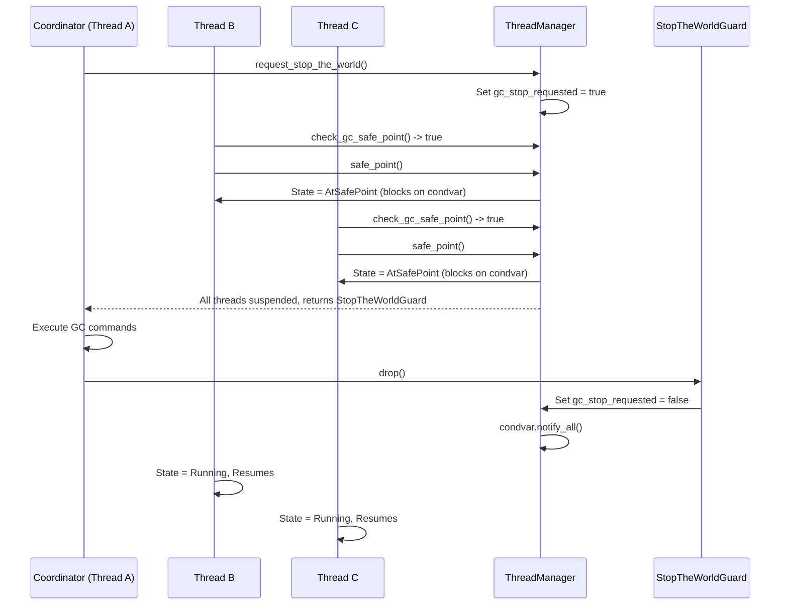

# Threading and Synchronization

This document describes the threading model, feature-gated implementations, monitor-style synchronization, and the coordination protocols between threads, GC, and static initialization.

## Overview

Threading is feature-gated with **two parallel implementations** that share a common trait interface:

| Feature          | Threading Module         | Sync Module                   | Behavior                                                |
|------------------|--------------------------|-------------------------------|---------------------------------------------------------|
| (none)           | `threading/stub.rs`      | `sync/single_threaded.rs`     | No-op thread ops, no locking                            |
| `multithreading` | `threading/basic.rs`     | `sync/threaded.rs`            | Real OS threads, monitor locks, and STW GC coordination |

The feature controls managed VM concurrency, not whether host code may create OS threads; the
CLI's Rayon pool, tracer, and integration-test timeout harness can do so in either configuration.

## Invariants

The `// SAFETY:` predicates for atomics, publication, lock order and per-thread state are stated
in the [invariant registry](INVARIANT_REGISTRY.md): `F4.WidthAligned`,
`F7.InitializationPublished`, `F8.LockOrderRespected`, `F8.NoSafepointWhileHeapBorrowed`,
`F11.ObjectPointerThreadSafe` and `F11.PInvokeLastErrorArenaLocal`.

## Thread Lifecycle (`threading/`)

### `ThreadManagerOps` Trait (`threading/mod.rs`)

Common interface implemented by both `basic::ThreadManager` and `stub::ThreadManager`. It uses a generic `Guard: STWGuardOps` to measure stop-the-world duration.

- `register_thread` / `register_thread_traced`: Assigns a managed `ArenaId` to the current OS thread.
- `unregister_thread` / `unregister_thread_traced`: Cleans up the thread state when it exits.
- `current_thread_id`: Returns the `ArenaId` for the calling thread, or `None` if unregistered.
- `thread_count`: Returns the number of currently active managed threads.
- `is_gc_stop_requested`: Returns `true` if a STW pause is pending. Checked at safe points.
- `safe_point` / `safe_point_traced`: Transitions the thread to `AtSafePoint`, waits for GC commands from the coordinator, and resumes when the STW pause ends.
- `execute_gc_command`: Dispatches a specific `GCCommand` (MarkAll, Sweep, etc.) to the local arena.
- `request_stop_the_world` / `request_stop_the_world_traced`: Initiates a STW pause, waiting until all threads are suspended. Returns a `Guard` that releases threads upon drop.

### Thread State Machine (`ThreadState` in `threading/mod.rs`)

```
Running → AtSafePoint → (GC runs) → Running
Running → Exited
```

The `ThreadState` enum (`threading/mod.rs`) has exactly three states:

- **`Running`**: Normal execution
- **`AtSafePoint`**: Thread has paused for GC, waiting for resume signal
- **`Exited`**: Thread has completed

### `ManagedThread` (`basic.rs`)
Each thread has:
- `native_id`: OS `ThreadId`
- `managed_id`: `ArenaId` (used as the thread's identity throughout the VM)
- Atomic `ThreadState`

### Stop-The-World Protocol (`basic.rs` → `request_stop_the_world`)

The Stop-The-World (STW) protocol synchronizes all managed threads to a halt so the `GCCoordinator` can safely trace and collect each arena. The GC is non-moving.



1. **Initiation**: The acquiring thread calls `request_stop_the_world`, which acquires the main thread lock and sets `gc_stop_requested = true`. It records a `start_time` (`Instant::now()`).
2. **Synchronization**: It loops over all registered threads, waiting on a condition variable until every thread's state transitions to `AtSafePoint` (or is already `Exited`).
3. **Execution**: Returns a `StopTheWorldGuard`. The coordinator now has exclusive access to the heap and issues commands via `execute_gc_command_for_current_thread`.
4. **Resumption**: When the `StopTheWorldGuard` is dropped, `gc_stop_requested` is cleared, and `resume_threads()` is called, which broadcasts a condition variable to wake all threads stuck in `safe_point`. The guard's `elapsed_micros()` provides the total pause timing.

**Panic guards**: `request_stop_the_world` arms a `ResumeOnPanic` guard before acquiring the thread lock; if a panic unwinds before `StopTheWorldGuard` is returned, `ResumeOnPanic::drop` calls `resume_threads()` so mutator threads are never permanently paused. During command execution inside `safe_point`, `CommandCompletionGuard` is typestated (`Armed`/`Disarmed`): armed drop signals `command_finished`, while `disarm(self)` transitions to a no-op drop state after the explicit manual completion signal.

### Stub Implementation (`stub.rs`)
- All operations are no-ops or return fixed values
- `is_gc_stop_requested` always returns `false`
- `safe_point` does nothing
- Compiles out managed-thread coordination overhead for single-threaded mode

### Scoped managed `Thread` support

With the `multithreading` feature, dotnet-rs supports the narrow lifecycle required by
this runtime: `Thread(ThreadStart)`, parameterless `Thread.Start()`, and parameterless
`Thread.Join()`. The `ThreadStart` must be an explicit static, parameterless method with
a `void` return type; a supported managed thread may be started once and joined once.
These handlers bypass CoreLib's QCall initialization for this subset.

This is not complete `System.Threading.Thread` compatibility. Unsupported cases include
other constructors, `Start(object)`, timeout-bearing `Join` overloads, and ThreadStart
delegates with an instance target (including capturing lambdas), non-static targets,
parameters, or a non-`void` return type. Background, priority, culture, and other thread
configuration APIs and ThreadPool scheduling are also outside this subset. In builds without
`multithreading`, managed
`Thread(ThreadStart)` construction and `Start()` explicitly report unsupported rather
than spawning a worker.

### Managed worker lifecycle and process exit

`SharedGlobalState` owns the native worker handles, and one registry lock protects each worker's
lifecycle and managed result. A worker follows
`Running → Completed(outcome) → Retired ⇄ Finalizing`; shutdown transitions from `Retired` to
`ShuttingDown`, then `Drained` or `Leaked`. A panic follows the existing drain-or-leak path.
`Thread.Join` observes `Completed` and consumes the outcome without waiting for the native thread.
After segment cleanup and publication, the completed owner stops ordinary managed execution, remains registered
for GC and leases, and services coordinator commands on its own thread. After collection it may run
only queued finalizer segments, then returns to the service loop. An abort interrupts a
non-terminating finalizer. The [GC contract](GC_AND_MEMORY_SAFETY.md#retired-worker-arenas) describes
the collection-exclusion and exact-lease-drain ordering.

After Main returns, `Executor::wait_for_foreground_workers` keeps the entry arena registered,
services GC stops and its own finalizers, and waits for running workers and global finalizer work
before reporting exit. All supported workers are foreground because `IsBackground` is
unimplemented. `Thread::InternalFinalize` has no native handle to release because the registry
owns those handles. The CLI and in-process harness explicitly call
`SharedGlobalState::shutdown_workers` after dropping the entry executor; shutdown must not be
deferred to shared-state destruction because worker executors hold that state. Shutdown signals
retired owners and joins their native handles after they drain or deliberately leak their arenas.

Retaining a completed worker costs one OS thread and its arena until VM shutdown. Arena IDs are
monotonic and the process supports at most 65,535 IDs, so this policy deliberately trades bounded
process-lifetime capacity and per-worker resources for correct retained references. The detailed
design and acceptance checks are in the [retained-arena plan](plans/09-retired-arena-lifetime.md).

## Safe Points

A thread stops for a collection only between the `mutate_root` calls made by the executor loop
(`Executor::run`), which checks `is_gc_stop_requested` and calls `ThreadManagerOps::safe_point`.
The interpreter returns to that loop, usually with `StepResult::Yield`, when a poll observes a
pending request:

- **Dispatch loop.** `ExecutionEngine::run` (`crates/dotnet-vm/src/dispatch/mod.rs`) polls
  `CallStack::check_gc_safe_point` on entry and before each exception-handling step. Inside an
  instruction batch it polls every `DOTNET_SAFE_POINT_POLL_INTERVAL` instructions (32 by
  default; 64 and 128 are also accepted). Branches stay inside the batch. A batch ends after 128
  instructions, or earlier at any result other than `Continue` (for example a call that pushes a
  frame, a yield or an exception), and control returns to the executor loop.
- **Long-running operations.** Chunked intrinsics and handlers (string, span, `Unsafe`/`Buffer`
  block operations, `cpblk`/`initblk`, array operations, some reflection) call the scope-aware
  `RawMemoryOps::check_gc_safe_point` on `VesContext` between chunks and yield.
- **Waits.** Monitor waits (`enter_safe`) and static-constructor waits (`wait_for_init`) check
  for a pending stop while blocked; see below.

There are two `check_gc_safe_point` methods. `CallStack::check_gc_safe_point` is a bare
`is_gc_stop_requested()` load. `VesContext`'s `RawMemoryOps::check_gc_safe_point`
(`stack/raw_memory_ops_impl/mod.rs`) also consults the `GcScopeGuard` counter.

### Safe Point ↔ GcScopeGuard Interaction
When a `GcScopeGuard` is active (the `active_borrows` scope counter > 0), `VesContext`'s `RawMemoryOps::check_gc_safe_point` returns `false` early without blocking. (The plain `CallStack::check_gc_safe_point` does *not* consult the counter — it only loads `is_gc_stop_requested()`.) This prevents deadlocks when a thread holds GC-managed borrows but the coordinator requests STW.

The path to thread suspension:
1. `VesContext::check_gc_safe_point()` first checks the `active_borrows` scope counter; if it is > 0 it returns `false` to prevent deadlocks (the thread cannot safely park while holding GC borrows). Otherwise it evaluates `ThreadManager::is_gc_stop_requested()`.
2. If `true`, the operation yields after bounded work. Legacy initializer triggers use `yield_and_retry`; native activations retain their progress and resume without replaying the instruction.
3. The executor loop in `crates/dotnet-vm/src/executor.rs` sees the request after `mutate_root` returns and calls `ThreadManagerOps::safe_point(thread_id, coordinator)`.
4. In `basic.rs`, `safe_point()` first short-circuits (returns immediately) if `is_gc_stop_requested()` is false or the thread-local `IS_PERFORMING_GC` flag is set; otherwise it sets the thread state to `AtSafePoint`, notifies the STW coordinator, and blocks on a condition variable.
5. While blocked, it may be woken up to process a `GCCommand` (via `execute_gc_command_for_current_thread`) before going back to sleep.
6. Once the STW guard is dropped, the condition variable is pulsed, the state resets to `Running`, and execution resumes.

### Cross-arena leases and shared access

Under `multithreading`, cross-arena checked operations acquire an `ArenaLease` for each
synchronous access or closure, and `RetainedPtr` keeps one across a block operation. Leases must
be dropped before the thread parks at a safepoint. What a lease does and does not guarantee is
stated once, in [GC and Memory Safety](GC_AND_MEMORY_SAFETY.md#arena-liveness-and-leases).
There is no common protocol ordering overlapping raw, locked, atomic and static accesses to shared
storage.

## Monitor Synchronization (`sync/`)

### `SyncManagerOps` and `SyncBlockOps` Traits (`sync/mod.rs`)

Implements .NET's `Monitor.Enter`/`Monitor.Exit` semantics (the `lock` keyword) and `wait`/`pulse` signals.

- `SyncManagerOps`:
  - `get_or_create_sync_block`: Lazily allocates a sync block index for an object layout.
  - `get_sync_block`: Retrieves an existing sync block by index.
  - `try_enter_block`: Attempts to acquire a block without waiting.
- `SyncBlockOps`:
  - `try_enter`: Non-blocking lock attempt.
  - `enter`: Blocking lock acquisition. Records contention metrics.
  - `enter_with_timeout`: Blocking lock with an explicit timeout.
  - `enter_safe`: Blocking lock with GC safe point awareness. Periodically yields to allow STW pauses.
  - `enter_with_timeout_safe`: Timed lock with GC safe points.
  - `exit`: Release the lock (decrements recursion count; unlocks if 0).
  - `wait` / `pulse` / `pulse_all`: Condition variable operations (Monitor.Wait/Pulse).

### Threaded Implementation (`sync/threaded.rs`)

- **`SyncBlockManager` Data Structure**: Uses a `Mutex<HashMap<NonZeroUsize, Arc<SyncBlock>>>` mapping a unique index to a sync block, and a `Mutex<usize>` (starting at 1) for index generation.
- **`SyncBlock` Data Structure**: Contains a `Mutex<SyncBlockState>` and a `Condvar`.
- **`SyncBlockState`**: Tracks the `owner_thread_id` (`ArenaId`) and `recursion_count` to support re-entrant locking by the same thread.
- Objects are identified by their sync block index, stored in the `ObjectInner::sync_block_index` field (`0` means none yet).
- `enter_safe` uses a `loop` with a configurable yield interval (default 10ms). Periodically, it wakes up, drops the lock, and checks `thread_manager.is_gc_stop_requested()`. If a STW pause is pending, it returns `LockResult::Yield` without calling `safe_point()` directly — the caller converts this to `StepResult::Yield`, and the executor's main loop drives the safe-point handshake on the next iteration. This prevents deadlocks when a thread waiting for a monitor lock is asked to suspend by the GC.

#### `get_or_create_sync_block` two-step contract

`SyncBlockManager::get_or_create_sync_block` takes `current_index: Option<NonZeroUsize>` and returns
`(new_index, Arc<SyncBlock>)`.

- The manager does all map/index allocation work internally while `SyncBlockManager::blocks` is
  locked.
- No external callbacks execute under `blocks`, so callers cannot accidentally re-enter sync-block
  APIs from inside a lock-held closure.
- Callers must publish `new_index` to object state only after `get_or_create_sync_block` returns
  (that is, after the manager lock has been released).

Current multithreaded call path:
`VesContext::monitor_get_or_create_sync_block_for_object`
(`crates/dotnet-vm/src/stack/context_ops.rs`) reads the object's current index, calls
`get_or_create_sync_block(current_index)`, then publishes the returned index with
`object.set_sync_block_index(gc, new_index)` only after the call returns.

### Configuration

#### Environment Variables

| Variable | Default | Description |
|----------|---------|-------------|
| `DOTNET_SAFE_POINT_YIELD_MS` | `10` | The interval (in milliseconds) at which a thread waiting for a monitor lock will wake up to check for a GC safe point request. Lower values reduce GC pause latency but increase CPU overhead during lock contention. |

### Single-Threaded Implementation (`sync/single_threaded.rs`)

- Tracks lock ownership for correctness checking but never actually blocks
- Detects re-entrant locks and recursive lock errors
- Useful for catching synchronization bugs in single-threaded testing

## Non-Obvious Connections

### Threading ↔ GC Coordinator
`ThreadManager` holds a `Weak<GCCoordinator>` (set via `set_coordinator`). The coordinator uses the thread manager to:
- Know which threads exist
- Wait for all threads to reach safe points
- Resume threads after collection

### Threading ↔ Static Initialization

`StaticStorageManager::init` claims a constructor under its initialization mutex. Same-thread
recursion and detected wait cycles follow the recursive-initialization policy; a single-threaded
build cannot wait for another thread. An owned wait registration removes its particular edge on
completion, cancellation or unwind. The graph can hold multiple edges from one arena because a
finalizer or a suspended exception segment can have its own wait while another is parked. Cycle
checking and insertion are atomic under the graph lock.

`VmEffects::ensure_initialized` runs a claimed constructor through a capturing call. Its claim
publishes success or failure and wakes waiters; abandoning it publishes failure without running
managed code. Wait registrations are held by the activation and block outside mutations in
bounded intervals. `Executor` releases them before a GC stop or collection so the resumed effect
probes and checks for a cycle again. Notifications make the waiter eligible to re-probe.
`VesContext::initialize_static_storage` retains its existing in-mutation condition wait for
legacy callers and releases its registration before returning or yielding.

### Threading ↔ Executor
Each `Executor` owns a `GCArena`: directly in ST and via a private owner-qualified TLS slot in MT. Thread creation (`threading/basic.rs`) spawns a new OS thread, which creates its own `Executor` and registers with the `ThreadManager`. The arena ID serves as both the GC arena identifier and the managed thread ID.

`CallStack` owns the executor's `ArenaLocalState`, including the cached P/Invoke last-error scalar; `VesContext` borrows it directly, so no ThreadManager lookup or shared lock is involved. Native `errno`/`GetLastError` capture at the P/Invoke boundary is not implemented.

### SyncBlock ↔ Object Identity
Monitor locks are keyed by a lazily allocated sync block index stored in the object's `ObjectInner`. Sync blocks are therefore allocated on demand, and objects without a monitor carry only the zero index.

### Feature Flag Interactions
- `multithreading`: Full multi-threaded execution with per-thread arenas, monitor locking, and STW coordination across arenas.
- The stub threading module compiles out ALL threading overhead, including atomic operations in some cases.

## Canonical Lock Order (Multithreading)

The authoritative typed lock DAG is the `define_lock_order_dag!` invocation in
[`crates/dotnet-utils/src/sync/lock_order.rs`](../crates/dotnet-utils/src/sync/lock_order.rs).
The table below is its human-readable view of the observed runtime chains for
`feature = "multithreading"`; the source `roots` and `edges` declarations determine which
`AcquireAfter` implementations exist. Acquire locks only in the listed direction. Any reverse
acquisition is a lock-order bug.

`Unlocked` is a sentinel, not an acquirable lock. Of the concrete lock levels, only
`SyncBlockManager::next_index` is omitted from `roots`: its unqualified `.lock()` does not
compile and it must be acquired with `.lock_after()` while `SyncBlockManager::blocks` is held.
The other levels remain root-acquirable for legitimate top-level paths, so callers must not use
an unqualified acquisition merely because another guard happens to be in scope.

| Chain | Ordered locks | Observed call path(s) |
|-------|---------------|-----------------------|
| GC/STW top-level | `GCCoordinator::collection_lock` → `ThreadManager::gc_coordination` | `Executor::perform_full_gc` (`begin_collection` then `request_stop_the_world`) |
| STW bookkeeping | `ThreadManager::gc_coordination` → `ThreadManager::threads` | `ThreadManager::request_stop_the_world` (thread counts, warning dump) |
| Thread registry under collection | `GCCoordinator::collection_lock` → `ThreadManager::threads` | Thread-registry reads while a `CollectionSession` holds the collection lock |
| GC command routing | `GCCoordinator::collection_lock` → `GCCoordinator::arenas` → `ArenaHandle::current_command` | `CollectionSession::{send_command_to_all_and_wait,wait_on_other_arenas,enqueue_command_for_arena}` |
| GC cross-arena table | `GCCoordinator::collection_lock` → `GCCoordinator::cross_arena_refs` | `CollectionSession::collect_all_arenas` |
| Static init deadlock detection | `StaticStorage::init_mutex` → `StaticStorageManager::wait_graph` | `StaticStorageManager::init` (`INIT_STATE_INITIALIZING` branch) |
| Monitor metadata allocation | `SyncBlockManager::blocks` → `SyncBlockManager::next_index` | `SyncBlockManager::get_or_create_sync_block` |
| Per-monitor ownership | `SyncBlock::state` is a leaf lock | `SyncBlock::{enter,enter_safe,exit}` |

### Forbidden Inversions

- For any path that needs both locks, acquire `GCCoordinator::collection_lock` before `ThreadManager::gc_coordination` (never the reverse).
- `ThreadManager::threads` must never be held while trying to acquire `ThreadManager::gc_coordination`.
- `GCCoordinator::arenas` or `ArenaHandle::current_command` must never be held while trying to acquire `GCCoordinator::collection_lock`.
- `ArenaHandle::current_command` must never be held while calling paths that take `GCCoordinator::arenas` (for example `get_arena`, `get_all_arenas`, `command_finished`).
- `StaticStorageManager::wait_graph` must never be held while acquiring `StaticStorage::init_mutex` (keep `wait_graph` updates short and non-blocking).
- A `StaticWaitRegistration` must retire its own wait-graph edge before a terminal return or a GC-stop retry; unrelated registrations on the same thread remain intact.
- `SyncBlockManager::next_index` must never be acquired before `SyncBlockManager::blocks`.
- Callers of `SyncBlockManager::get_or_create_sync_block` must publish the returned sync-block index only after the call returns (after `blocks` is released).
- `SyncBlock::state` must be dropped before any safe-point check (`is_gc_stop_requested` / `check_gc_safe_point`) to avoid blocking STW progress while waiting on monitor ownership.

The trait-level inversion rules above are guarded by negative compile-time `AcquireAfter`
assertions beside the DAG, including a separate assertion that
`SyncBlockManager::next_index` is not root-acquirable. The wait-registration cleanup,
sync-block-index publication, and `SyncBlock::state` safe-point rules are sequencing/lifetime
invariants that are not expressible as trait edges; they remain enforced by the implementation
structure and code review.

## Subsystem Details

### GC Command Processing (`execute_gc_command_for_current_thread`)
During a STW pause, the coordinator issues commands (like `MarkAll`, `MarkObjects`, `Finalize`, `Sweep`). Suspended threads briefly wake up to execute these commands locally via `execute_gc_command_for_current_thread` in `basic.rs`. In MT they access the optional Box through the private TLS slot without needing a global arena lock; if the Box is absent (including after extraction), the command performs no arena work. Once the local arena command completes, the thread goes back to the `AtSafePoint` suspended state. `CommandCompletionGuard<Armed>` wraps each command dispatch so panic paths still signal `command_finished`; normal paths call `disarm(self)` and then explicitly signal completion once.

### Cross-Arena References (`record_found_cross_arena_refs`)
In a multi-arena GC, objects in one thread's arena might reference objects in another. During the `MarkAll` or `MarkObjects` phase, when a thread discovers a reference pointing outside its own arena, it logs it. `record_found_cross_arena_refs` takes these accumulated references and registers them with the central `GCCoordinator` so they can be pushed to the owning arena's root set in a subsequent marking iteration.

Cross-arena discovery transports `CrossArenaRef`: the retained raw pointer and exact registration identity, not a reconstructed numeric address. Producers capture identity under a lease or carry the existing origin identity; harvest reacquires an exact lease. The owner checks its original identity and a live exact lease before installation, and publishes roots via `mutate_root`.

MT executor teardown (extraction, thread affinity, draining and deliberate leaks on incomplete cleanup) follows the [arena lifecycle contract](GC_AND_MEMORY_SAFETY.md#per-thread-arenas).

### Thread-Local Storage Patterns
- `THREAD_ARENA` (MT only): private `RefCell<Option<Slot>>`, where `Slot` holds an optional exact identity and optional `Box<GCArena>`. An initializing or extracted slot remains reserved until its owner drops; internal safepoint dispatch can borrow the Box but cannot replace or extract it.
- `MANAGED_THREAD_ID`: A thread-local `Cell<Option<ArenaId>>` in `dotnet_utils::sync`. Cached via `get_current_thread_id()` to avoid repeatedly querying the ThreadManager for identity.

### Architecture Routing (`SharedGlobalState`)
The concrete `ThreadManager` (implementing `ThreadManagerOps`) is instantiated once and held as `Arc<ThreadManager>`. It is distributed throughout the VM by being embedded inside `SharedGlobalState` (the `thread_manager` field). Every `VesContext` has a reference to `SharedGlobalState`, granting all CIL instructions and BCL intrinsics access to threading and synchronization primitives.

### Utility Locks (`dotnet_utils::sync`)
The codebase uses a conditional aliasing pattern in `dotnet-utils/src/sync.rs` to abstract locking:
- **With `multithreading`**: Aliases point to `parking_lot::Mutex` and `parking_lot::RwLock`.
- **Without `multithreading`**: Aliases point to `compat::Mutex` and `compat::RwLock`, which are lightweight wrappers around `std::cell::RefCell` (bypassing OS locking overhead entirely). These wrappers intentionally do not implement `Sync`.
  In this configuration, `SharedGlobalState` is deliberately `!Send` and executor-confined. The
  integration-test timeout waiter receives only an `AbortSignal`, whose private state is an
  `Arc<AtomicBool>`; it cannot access the VM state or compat locks.
*(Note: `ThreadSafeLock` lives in `dotnet-utils/src/gc/thread_safe_lock.rs` as a GC-specific lock wrapper that switches between `parking_lot::RwLock` (multi-threaded) and `gc_arena::RefLock` (single-threaded). The general-purpose `Mutex`/`RwLock` aliases in `dotnet-utils/src/sync.rs` are separate.)*

## Asynchronous Exceptions (Thread.Abort and Thread.Interrupt)

### Thread.Abort

Following the direction of modern .NET (.NET 5+ and .NET Core), `dotnet-rs` **does not support** `Thread.Abort`. 

- **Rationale**: `Thread.Abort` is inherently unsafe as it injects a `ThreadAbortException` at arbitrary execution points (asynchronous exceptions per ECMA-335 §I.12.4.2.3). This can interrupt static constructors, leave shared state in an inconsistent manner, or fail to release unmanaged resources.
- **Compliance**: While ECMA-335 §I.12.4.2.3 describes the mechanism for asynchronous exceptions, it does not mandate that a CLI implementation must provide a public `Thread.Abort` API.
- **Behavior**: The VM has no `Thread.Abort` intrinsic and no guard for it. A call reaches whatever the loaded CoreLib or support assembly provides; the VM does not itself throw `PlatformNotSupportedException` as modern .NET does.

### Thread.Interrupt

`Thread.Interrupt` is **not implemented** in the `dotnet-rs` VM.

- Modern .NET supports `Thread.Interrupt` for waking threads from waiting states (`Wait`, `Sleep`, `Join`). The VM's thread state machine has no interruptible-wait state and never raises `ThreadInterruptedException`.

## Upstream Crate Contributor Notes

### `dashmap`: Deadlock Caveats (`len` / `iter_mut` / shard references)

**Source reference:** `dashmap 6.1.0`, `DashMap::len`, `DashMap::iter_mut` and the `Ref`/`RefMut` guards.

`DashMap` shards its data across a fixed set of `RwLock`-protected buckets. Several operations lock **all** shards simultaneously, which interacts dangerously with live shard references:

#### Self-deadlock rules
- **`DashMap::len()`** acquires a read lock on every shard in order to sum their lengths. If the calling thread already holds **any** shard reference on the same map (from `get()`, `get_mut()`, `entry()`, or a live iterator), calling `len()` will deadlock.
- **`DashMap::iter_mut()`** holds write locks on all shards for the duration of the iterator. No concurrent read or write to the map can proceed while the iterator is live. Do not hold an `iter_mut()` iterator across an `await` point or across a scope that calls back into the same map.
- **Shard reference lifetimes**: `Ref<'_, K, V>` and `RefMut<'_, K, V>` guards returned by `get()`/`get_mut()` hold a shard read/write lock. Always drop these guards before calling any full-map-locking method on the same `DashMap`.

#### Usage rules in this codebase
- All `DashMap` accesses in the VM (reflection caches, static storage, arena registry) use `get` / `insert` / `entry` and release the guard before any subsequent operation on the same map.
- **Never call `len()` while holding a `Ref` or `RefMut` from the same map.** If a count is needed for metrics or logging inside a code path that already holds a shard guard, capture the count before entering the guarded scope or use a separate `AtomicUsize` counter.
- When iterating with `iter()` or `iter_mut()`, complete the iteration and drop the iterator before calling `insert`, `remove`, `get`, or `len` on the same map.

---

### `crossbeam-channel`: Bounded vs Unbounded Behavior

**Source reference:** `crossbeam-channel 0.5.15`, `bounded`, `unbounded`, `Sender::try_send` and `select!`.

`crossbeam-channel` offers two channel flavors with fundamentally different backpressure properties:

#### Unbounded channels (`unbounded()`)
- The sender **never blocks** and the channel grows without limit.
- Risk: a producer that outpaces the consumer will cause unbounded heap growth, eventually leading to OOM.
- **Do not introduce new unbounded channels** in hot VM paths (execution dispatch, GC, or tracing) without an explicit justification and a documented drop/trim policy.

#### Bounded channels (`bounded(n)`)
- The sender blocks on `send()` when the channel is at capacity, providing natural backpressure.
- `try_send()` returns `Err(TrySendError::Full(_))` immediately when full; the caller is responsible for the drop/retry policy.
- `try_recv()` returns `Err(TryRecvError::Empty)` immediately when the channel is empty.

#### Current usage in this codebase
- The tracer (`crates/dotnet-tracer/src/lib.rs`) uses a **bounded** channel with `TRACER_CHANNEL_CAPACITY = 8_192` and `try_send` on the hot path. Events dropped due to a full channel are counted in `dropped_by_backpressure` (`AtomicU64`) and reported as a `LogEntry::DroppedByBackpressure(u64)` summary entry in the flusher, so loss is always visible in logs.
- Any new diagnostic or inter-thread channel must use `bounded` with an explicit capacity and a documented policy for `TrySendError::Full` (drop-newest, drop-oldest, or block).
- **Never use `send()` (blocking) on a channel from the VM execution thread** — this stalls managed code execution and can interact with the STW safe-point protocol, potentially causing a deadlock if the receiver thread is itself waiting at a safe point.
- **`select!` with multiple bounded channels**: if all branches are full and no receiver is draining, the `select!` macro will block indefinitely. Prefer `try_send`/`try_recv` variants (`select!` with `default`) in hot paths.

---

### `parking_lot`: Condvar One-Mutex Rule and Fairness

**Source reference:** `parking_lot` (current pinned version), `Condvar` docs.

#### One-mutex rule (enforced at runtime)
`parking_lot::Condvar::wait(&self, guard: MutexGuard<'_, T>)` records the address of the mutex that issued the guard on the first `wait` call. **Every subsequent `wait` on the same `Condvar` must supply a guard from that exact same mutex.** Violating this rule causes an unconditional panic at runtime:

```
attempted to use a condition variable with two mutexes
```

Rules in this codebase:
- Each `Condvar` must be declared alongside its paired `Mutex` as a logical unit (e.g., in the same struct or adjacent `static`/field slots).
- **Never pass a guard from mutex A to a `Condvar` that was previously used with mutex B**, even if the types are identical. For example, `ThreadManager::all_threads_stopped` (`crates/dotnet-vm/src/threading/basic.rs`) is always waited on with the `ThreadManager::gc_coordination` guard.
- When refactoring: if a `Condvar` is moved to a new mutex, also reset (replace) the `Condvar` itself.

#### Fairness and notification semantics
`parking_lot::Mutex` uses a **fair** (queue-based) scheduling algorithm:
- Threads that have been waiting longer receive priority. This prevents starvation but slightly increases average lock-acquisition latency compared to an unfair spinlock.
- `Condvar::notify_one()` wakes the **longest-waiting** thread in the wait set, not an arbitrary one.
- `Condvar::notify_all()` wakes **all** waiting threads; each then races to re-acquire the paired mutex. Use this for broadcast scenarios (e.g., resuming all threads after a STW pause via `resume_threads()`).
- `parking_lot` mutexes do **not** support lock poisoning (unlike `std::sync::Mutex`). A thread that panics while holding a `parking_lot` mutex simply drops the guard normally; the mutex is released without poisoning. This is intentional — it matches the codebase's use of RAII cleanup guards and means `lock()` always returns a `MutexGuard` directly (no `LockResult` unwrapping needed).

#### Deadlock detection
`parking_lot` does **not** detect deadlocks by default. For debugging suspected deadlock scenarios, enable the `deadlock_detection` cargo feature of `parking_lot` locally and call `parking_lot::deadlock::check_deadlock()` from a background thread. Do not enable `deadlock_detection` in production or CI builds — it adds per-lock overhead.
